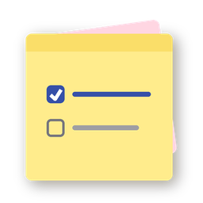
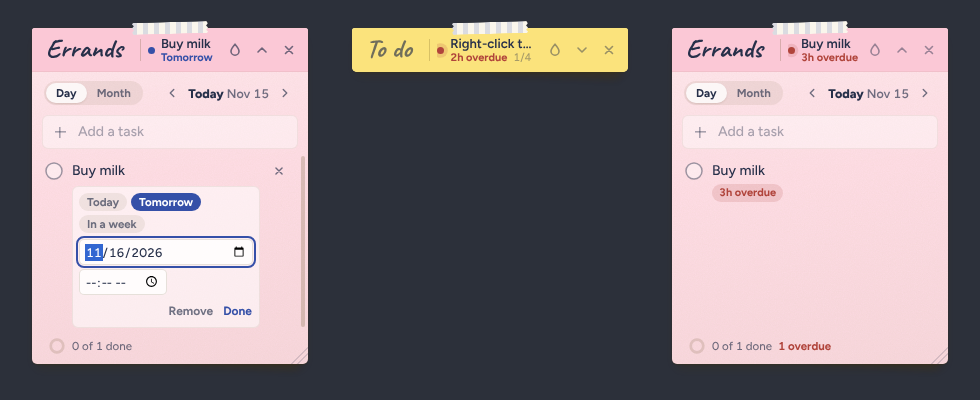
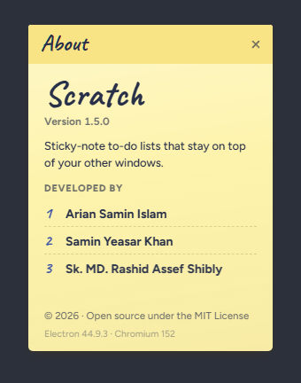

<p align="center">
  
</p>

<h1 align="center">Scratch</h1>

<p align="center">Sticky-note to-do lists that stay on top of your other windows.<br>
A free, open-source Windows desktop app, developed by Arian, Sadif and Shibly.</p>

<p align="center">
  
</p>

Scratch puts small paper notes on your desktop that float above Chrome, VS Code and everything else, so your to-do list is always in view. Plan a day or a month, tick tasks off with a pen-stroke animation, set deadlines with countdowns and reminders, and collapse a note to a single strip that keeps cycling through what's next.

- **Daily lists and monthly goals**, with today's notes marked by a strip of tape
- **Deadlines** with live countdowns, overdue warnings and Windows notifications
- **Always on top**, movable anywhere, remembers where you put each note
- **Twelve pastel colors** and adjustable transparency
- **Pomodoro timer** (25 minutes on and 5 off by default, or any length you choose), a manager for hidden notes, and a Settings window
- **Starts with Windows** if you want it to; works offline; your notes never leave your PC

## Download

Get **`Scratch_Setup.exe`** from the [latest release](../../releases/latest). It installs for your Windows account only, with no administrator rights needed, and runs on Windows 10 and 11 (64-bit).

The installer is not code-signed yet, so Windows SmartScreen may say "Windows protected your PC". Click **More info**, then **Run anyway**.

On a **Mac**, get **`Scratch.dmg`** from the same release, open it and drag Scratch into Applications. It runs on Intel and Apple silicon Macs. The app isn't notarized by Apple yet, so the first time you open it macOS says it "could not verify" Scratch: click **Done**, then go to **System Settings › Privacy & Security**, scroll down and click **Open Anyway**.

Updating from **Sticky Notes** (Scratch's earlier name)? Just run the new installer: it replaces Sticky Notes and brings your notes across.

## Using Scratch

- **New note:** click the note pad in the bottom-right corner, or hover over it and choose **Sticky note** or **Notepad**. Drag the small grip above it to move it.
- **Menu:** the `⋯` button under the pad, right-clicking the pad, or right-clicking the tray icon: collapse all, expand all, Settings, open data folder, About, and quit. The clock and archive buttons next to it open the Pomodoro timer and the hidden notes.
- **Move a note:** drag its coloured top strip. Notes snap back inside the screen if dropped partly off it.
- **Resize:** drag the bottom-right corner.
- **Tasks:** type and press Enter. Click the circle to check off; click again to undo. Double-click the text to edit (Enter saves, Escape cancels). Hover a task for the delete button.
- **Day / Month:** each note is either a list for one day or goals for a month. Use the arrows or click the date to change it. Today's daily notes have a strip of tape across the top.
- **Deadlines:** hover any task and click the calendar icon. Pick Today, Tomorrow or In a week, or choose a date; the time is optional. The task then shows a small countdown ("in 1h 29m", "Tomorrow", "in 5 days") that turns amber on the day and red once it is late ("3h overdue"). Click the countdown to change or remove the deadline. The note's footer, and its strip when collapsed, show how many tasks are overdue.
- **Reminders:** when a deadline arrives, Windows shows a notification; click it to bring up the note. A deadline with no time reminds at 9:00 that morning (you can change the hour in Settings). Each deadline reminds once, and again only if you change it. Completed tasks never remind. If several came due while the PC was off, you get one summary instead of a pile. Turn this off with "Deadline reminders" in the menu.
- **Completed tasks** move to a "Completed" section at the bottom of the note, which you can fold away. Unticking a task puts it back.
- **Color and transparency:** the drop icon on a note opens its colors and an opacity slider (30% to 100%). It works on collapsed notes too. "Transparency" in Settings sets every note at once.
- **Rotating headline:** each note's top strip cycles through its unfinished tasks every few seconds, most urgent first: overdue tasks (red, with a pulsing dot and how late they are), then the nearest deadlines, then the rest. Under each task is its countdown and its place in the rotation ("2/5"). When you finish a task or a deadline makes one more urgent, it starts again from the most urgent. It's most useful on a collapsed note: you can see what's next without opening it. Switch it off with "Rotating tasks in note headers" in the menu.
- **Collapse:** the chevron shrinks a note to its top strip. **Close (×)** hides it; it is not deleted. Right-click the top strip to delete a note permanently or clear its completed history.
- **Hidden notes:** the box button under the pad (it shows a count) opens a list of hidden notes. Tick some and restore or delete them together, or use Restore all / Delete all. Deleting always asks first.
- **Pomodoro:** the clock button under the pad opens a focus timer (25 minutes by default) followed by a break (5 minutes). Pick a preset or type your own lengths in the window; a session already under way finishes at its current length and the new lengths apply from the next one. It keeps counting if you close its window, notifies you when time is up, and counts today's finished sessions.
- **Notepads:** hover over the note pad and choose **Notepad** (or "New notepad" in the menu) for a paint-style drawing pad on notepad paper (lined, grid, dotted or plain). You can have as many as you like; click the title to rename one. Closing a notepad hides it: it waits under Hidden notes, where you can restore or delete it like a note. Draw with the mouse or a pen with the pen, highlighter, eraser, fill, colour picker, text, line, arrow, rectangle and ellipse tools, in any colour and size. Paste a picture with Ctrl+V (or drop one in, or use the picture button), then drag it or its corners before it's placed. The select tool lifts part of the drawing to move, resize, copy (Ctrl+C), cut (Ctrl+X) or delete it. Undo with Ctrl+Z, redo with Ctrl+Y, full screen with F11 or the full-screen button, and Ctrl+S saves the page as a PNG picture. The drawing is saved automatically.
- **Settings:** "Settings…" in the menu. Window size (80% to 150%), transparency for all notes, animations on or off, keep on top, rotating headlines, what the + pad creates (daily list or monthly goals), the color of new notes, deadline reminders (and the hour for deadlines with no time), notification sound, opening at sign-in, collapsing notes at launch, Pomodoro lengths, starting the next focus session by itself, Pomodoro alerts, and "Restore default settings".

Notes are saved automatically to `%APPDATA%\Scratch\sticky-notes.json` ("Open data folder" in the menu). Nothing leaves your PC.

**About:** "About Scratch" in the menu shows the version, the developers and the licence.


## Build from source

You need [Node.js](https://nodejs.org) 20 or newer and Git.

```
git clone <this repository's URL>
cd scratch
npm install
npm run dev        # run with live reload
npm test           # unit tests
npm run dist       # build release\Scratch_Setup.exe (on Windows)
npm run dist:mac   # build release/Scratch.dmg (on a Mac only)
```

Building the installer on Linux or macOS also needs [Wine](https://www.winehq.org/). Maintainer notes on releases, the installer and signing are in [docs/RELEASING.md](docs/RELEASING.md).

## How it works

Every note is its own frameless, transparent `BrowserWindow`. That is what lets notes float independently above other apps and remember their own positions. The main process owns all data. A note window never sends a note id: the main process works out which note a window owns from the sender, and passes every change through `sanitizeNotePatch()` before saving it.

Security settings: `contextIsolation`, `sandbox` and no `nodeIntegration` on every window; navigation and new windows are blocked; all permission requests are denied; the production build carries a strict Content-Security-Policy; fonts are bundled so nothing is fetched from the internet.

Storage is a JSON file rather than SQLite because the data is small and always read whole, and a native SQLite module would need rebuilding for every Electron upgrade and installer build. Saves are written to a temporary file and renamed into place, the previous file is kept as `.bak`, and an unreadable file is moved aside (never overwritten) before falling back to the backup.


## Tests

```
npm test               # unit tests: validation, storage, reminders, countdowns, timer
./scripts/smoke.sh     # end-to-end: real windows, real keystrokes, then a restart
```

On Linux the smoke test needs `xvfb-run`. On Windows, run it from Git Bash; it uses Electron directly. Set `SMOKE_OUT_DIR` to keep the screenshots and results.


## Project layout

```
electron/
  main.js      windows, always-on-top, positions, tray, menus, IPC
  about.js     what the About window shows (developer names live here)
  migrate.js   one-time copy of notes from the old "Sticky Notes" folder
  startup.js   "start with Windows" (reads and writes the Run entry)
  reminders.js which deadlines are due (pure logic, unit tested)
  pomodoro.js  Pomodoro state machine (pure logic, unit tested)
  preload.js   the small API the UI is allowed to use (contextBridge)
  store.js     JSON file storage: debounced atomic writes + backup recovery
  schema.js    data defaults and validation of everything the UI sends
  smoke.js     end-to-end test (only loaded when STICKY_SMOKE_TEST=1)
  assets/      tray / window icon
src/
  components/  Note, TaskItem, DeadlineEditor, PeriodBar, ColorPicker,
               Launcher, Manager (hidden notes), Timer (Pomodoro), Settings, About, ...
  lib/         date helpers and React hooks
  styles/      base.css, note.css, launcher.css, panels.css
tests/         unit tests (node:test)
scripts/       smoke.sh (end-to-end app tests), test-installer-wine.sh (installer),
               make-install-guide.py (customer PDF)
build/         icon, installer script (installer.nsh) and installer side images
licenses/      licence texts of bundled third-party software
docs/          RELEASING.md and screenshots
.github/       issue and pull request templates, CI and release workflows
```

## Contributing

Bug reports, ideas and pull requests are welcome. Please read [CONTRIBUTING.md](CONTRIBUTING.md) first, and report security problems privately as described in [SECURITY.md](SECURITY.md).

## Developers

Scratch is developed by **Arian, Sadif and Shibly**:



1. Arian Samin Islam
2. Samin Yeasar Khan
3. Sk. MD. Rashid Assef Shibly

## License

[MIT](LICENSE) © 2026 Arian, Sadif & Shibly. Scratch bundles Electron, React and the Caveat and Figtree fonts under their own licences; see [THIRD_PARTY_NOTICES.md](THIRD_PARTY_NOTICES.md).
